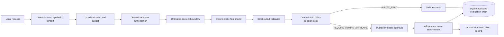

# Architecture

User questions and retrieved document content are untrusted data. Trusted instructions, policy, approvals, and tool enforcement are code-owned. A model proposal can never grant authorization.

Audit envelopes bind sequence, tenant, request, sanitized metadata, and prior hash. Evaluation records are digest-bound to their audit event. A tampered audit or evaluation record blocks `inspect` and `explain-decision`.
